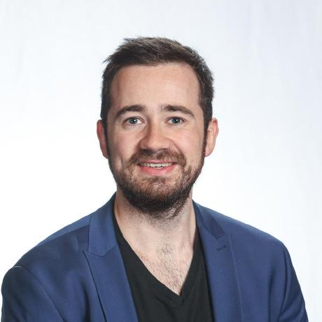

{.profile-photo .lightbox fig-alt="Portrait of Nico Meyer"}

I am Deputy Head and Senior Scientist of the [Quantum Compilation Group at Fraunhofer IIS](https://www.iis.fraunhofer.de/de/ff/lv/dataanalytics/quantum-machine-learning.html). My research brings together quantum error correction and fault-tolerance, quantum compilation, and distributed quantum computing with machine learning. My work spans theoretical research, open-source software, and experiments on quantum hardware.

I am also a PhD candidate at the [Pattern Recognition Lab of FAU Erlangen-Nürnberg](https://lme.tf.fau.de/persons/nico-meyer/), studying variational learning for noise-tailored quantum error correction.

## Explore

:::: {.explore-grid}
::: {.explore-card}
### [Publications](publications.qmd)

Papers and preprints on quantum computing and machine learning.
:::

::: {.explore-card}
### [Software](software.qmd)

Open-source tools and code from my research.
:::

::: {.explore-card}
### [Talks & Academic Service](talks.qmd)

Conference contributions, presentations, and peer review.
:::

::: {.explore-card}
### [Projects & Funding](projects.qmd)

Research projects, advisory roles, and funding acquisition.
:::

::: {.explore-card}
### [Awards](awards.qmd)

Recognition for research, presentations, teaching, and academic achievement.
:::

::: {.explore-card}
### [Contact & Impressum](contact.qmd)

Ways to get in touch and the legal notice for this website.
:::

::::

## Find me online

[GitHub](https://github.com/nicomeyer96) ·
[Google Scholar](https://scholar.google.de/citations?user=szfFv98AAAAJ&hl=de) ·
[LinkedIn](https://linkedin.com/in/nicomeyer96)

For inquiries, see [Contact & Impressum](contact.qmd).
