For further details and updates, see my [Google Scholar profile](https://scholar.google.de/citations?user=szfFv98AAAAJ&hl=de).

## 2026

:::: {.publication-card}
::: {.publication-figure}
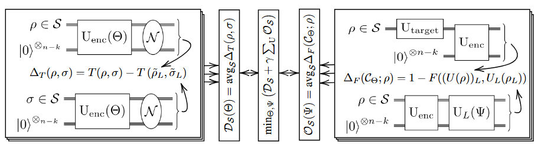{.publication-image .lightbox fig-alt="Variational early fault-tolerant quantum computing workflow"}

Image credit: Figure 1, Meyer et al., QCE 2026 · © 2026 IEEE · <a href="https://ieeexplore.ieee.org/Xplorehelp/downloads/license-information/IEEE.html">reuse terms</a>

:::

::: {.publication-details}
**Variational Early Fault-Tolerant Quantum Computing**

Nico Meyer, Christopher Mutschler, Dominik Seuß, Andreas Maier, Daniel D. Scherer.

*IEEE International Conference on Quantum Computing and Engineering (QCE)*, vol. 2, pp. 672–673, September 2026 (proceedings to appear).

This short conference version of “Learning Logical Operations for Arbitrary Quantum Error Correction Codes” describes VarEFTQC, a method for designing noise-adapted quantum codes together with their logical gates. It demonstrates a five-qubit non-additive code with a shallow universal gate set tailored to structured depolarizing noise.

:::
::::

:::: {.publication-card}
::: {.publication-figure}
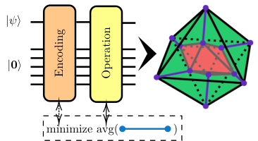{.publication-image .lightbox fig-alt="Schematic overview of learning logical operations for quantum error-correcting codes"}

Image credit: Figure 1, <a href="https://journals.aps.org/pra/abstract/10.1103/qj2x-3l6n">Meyer et al., <em>Physical Review A</em> (2026)</a> · © 2026 American Physical Society · <a href="https://journals.aps.org/licenses">reuse terms</a>

:::

::: {.publication-details}
**[Learning Logical Operations for Arbitrary Quantum Error Correction Codes](https://journals.aps.org/pra/abstract/10.1103/qj2x-3l6n)**

Nico Meyer, Christopher Mutschler, Dominik Seuß, Andreas Maier, Daniel D. Scherer.

*Physical Review A* **114**, 032424, 2026.

A learning-based framework finds physical implementations of logical gates directly from an encoding circuit, including for non-additive error-correcting codes. It also jointly optimizes encodings and logical operations for specific noise and gate-set requirements, with demonstrations on standard codes and an accompanying software library.

:::
::::

:::: {.publication-card}
::: {.publication-figure}
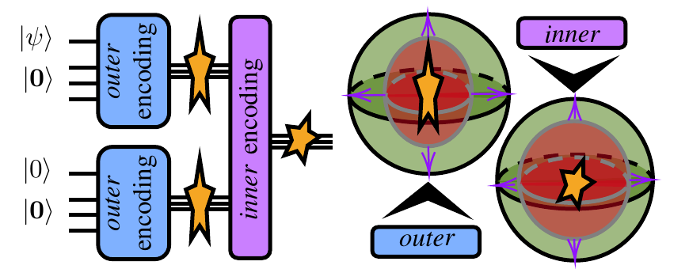{.publication-image .lightbox fig-alt="Schematic of noise-aware code concatenation"}

Image credit: Figure 1, Meyer et al., QCE 2026 · © 2026 IEEE · <a href="https://ieeexplore.ieee.org/Xplorehelp/downloads/license-information/IEEE.html">reuse terms</a>

:::

::: {.publication-details}
**[Learning to Concatenate Quantum Codes](https://doi.org/10.48550/arXiv.2604.14931)**

Nico Meyer, Christopher Mutschler, Dominik Seuß, Andreas Maier, Daniel D. Scherer.

*IEEE International Conference on Quantum Computing and Engineering (QCE)*, vol. 1, pp. 2838–2844, September 2026 (proceedings to appear; linked preprint).

This work adapts each level of quantum-code concatenation to the effective noise left by the preceding level. Learned, small encoders handle structured noise before conventional codes take over; simulations show that this combination can reach target logical error rates with substantially fewer physical qubits.

:::
::::

:::: {.publication-card}
::: {.publication-figure}
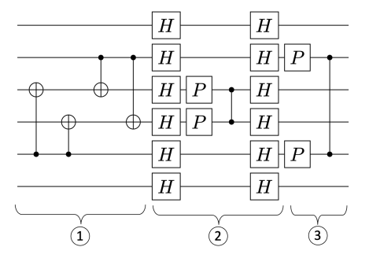{.publication-image .lightbox fig-alt="Three-stage compilation of a logical Clifford circuit"}

Image credit: Figure 4, <a href="https://ieeexplore.ieee.org/document/11668561">Popov et al., qCCL 2026</a> · © 2026 IEEE · <a href="https://ieeexplore.ieee.org/Xplorehelp/downloads/license-information/IEEE.html">reuse terms</a>

:::

::: {.publication-details}
**[Optimized Compilation of Logical Clifford Circuits](https://ieeexplore.ieee.org/document/11668561)**

Alexander Popov, Nico Meyer, Daniel D. Scherer, Guido Dietl.

*IEEE International Conference on Quantum Control, Computing, and Learning (qCCL)*, vol. 1, pp. 1–6, July 2026.

Rather than compile logical Clifford circuits gate by gate, the paper examines larger circuit blocks for an error-detecting code family. It derives depth-efficient compilation patterns from small instances and reports lower simulated error rates for several circuit structures.

:::
::::

## 2025

:::: {.publication-card}
::: {.publication-figure}
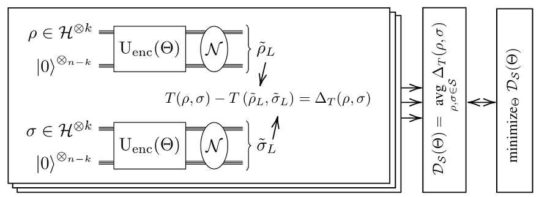{.publication-image .lightbox fig-alt="Training noise-adapted quantum error correction encodings"}

Image credit: Figure 1, <a href="https://ieeexplore.ieee.org/document/11249827">Meyer et al., QCE 2025</a> · © 2025 IEEE · <a href="https://ieeexplore.ieee.org/Xplorehelp/downloads/license-information/IEEE.html">reuse terms</a>

:::

::: {.publication-details}
**[Variational Quantum Error Correction](https://ieeexplore.ieee.org/document/11249827)**

Nico Meyer, Christopher Mutschler, Andreas Maier, Daniel D. Scherer.

*IEEE International Conference on Quantum Computing and Engineering (QCE)*, vol. 2, pp. 456–457, September 2025.

This short conference version of “Learning Encodings by Maximizing State Distinguishability: Variational Quantum Error Correction” uses the distinguishability of noisy quantum states to train noise-adapted error-correcting codes. It compares the learned encodings with standard codes and includes proof-of-concept experiments on quantum hardware.

:::
::::

:::: {.publication-card}
::: {.publication-figure}
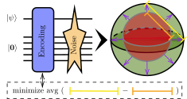{.publication-image .lightbox fig-alt="Noise-adapted quantum error correction encoding procedure"}

Image credit: Figure 1, <a href="https://iopscience.iop.org/article/10.1088/2058-9565/ae98b1">Meyer et al., <em>Quantum Science and Technology</em> (2026)</a> · © 2026 authors · <a href="https://creativecommons.org/licenses/by/4.0/">CC BY 4.0</a>

:::

::: {.publication-details}
**[Learning Encodings by Maximizing State Distinguishability: Variational Quantum Error Correction](https://iopscience.iop.org/article/10.1088/2058-9565/ae98b1)**

Nico Meyer, Christopher Mutschler, Andreas Maier, Daniel D. Scherer.

*Quantum Science and Technology* **11**(4), 045036, 2026.

Maximizing the distinguishability of encoded states after noise provides a training objective for variational quantum error correction. The resulting noise-adapted codes can reduce resource demands relative to standard codes in the studied settings; proof-of-concept tests run on IBM and IQM hardware.

:::
::::

:::: {.publication-card}
::: {.publication-figure}
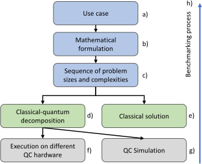{.publication-image .lightbox fig-alt="Figure 1: Decomposition of the BenchQC benchmarking workflow"}

Image credit: Figure 1, <a href="https://doi.org/10.1007/978-3-032-13852-1_21">Geissler et al., Springer (2026)</a> · <a href="https://arxiv.org/abs/2504.11204v1">arXiv v1</a> licensed <a href="https://creativecommons.org/licenses/by/4.0/">CC BY 4.0</a>

:::

::: {.publication-details}
**[BenchQC – Scalable and modular benchmarking of industrial quantum computing applications](https://doi.org/10.48550/arXiv.2504.11204)**

Florian Geissler, Eric Stopfer, Christian Ufrecht, Nico Meyer, Daniel D. Scherer, Friedrich Wagner, Johannes M. Oberreuter, Zao Chen, Alessandro Farace, Daria Gutina, Ulrich Schwenk, Kimberly Lange, Vanessa Junk, Thomas Husslein, Marvin Erdmann, Florian Kiwit, Benjamin Decker, Greshma Shaji, Etienne Granet, Henrik Dreyer, Theodora-Augustina Dragan, Jeanette Miriam Lorenz.

*International Quantum Engineering Conference and Exhibition (QUEST-IS)*, Springer CCIS vol. 2743, pp. 207–216, December 2025 (linked preprint).

BenchQC develops an application-led framework for evaluating quantum solutions to industrial use cases. Using the open-source QUARK platform, it measures the full workflow from application to hardware and compares approaches to identify where quantum computing might offer practical value.

:::
::::

:::: {.publication-card}
::: {.publication-figure}
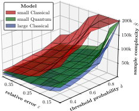{.publication-image .lightbox fig-alt="Comparison of sample complexities in quantum and classical reinforcement learning"}

Image credit: Figure 1, <a href="https://proceedings.mlr.press/v267/meyer25b.html">Meyer et al., ICML 2025</a> · © 2025 authors

:::

::: {.publication-details}
**[Benchmarking Quantum Reinforcement Learning](https://proceedings.mlr.press/v267/meyer25b.html)**

Nico Meyer, Christian Ufrecht, George Yammine, Georgios Kontes, Christopher Mutschler, Daniel D. Scherer.

*International Conference on Machine Learning (ICML)*, PMLR vol. 267, pp. 43934–43964, July 2025.

To compare quantum and classical reinforcement learning more reliably, the paper proposes statistical measures of sample complexity and outperformance. Experiments on a configurable benchmark question some earlier quantum-advantage claims while identifying more limited settings in which advantages may remain possible.

:::
::::

## 2024

:::: {.publication-card}
::: {.publication-figure}
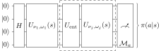{.publication-image .lightbox fig-alt="Quantum circuit used as the regularized policy approximator"}

Image credit: Figure 1, <a href="https://arxiv.org/abs/2410.21117v1">Meyer et al., arXiv (2024)</a> · © 2024 authors

:::

::: {.publication-details}
**[Robustness and Generalization in Quantum Reinforcement Learning via Lipschitz Regularization](https://doi.org/10.48550/arXiv.2410.21117)**

Nico Meyer, Julian Berberich, Christopher Mutschler, Daniel D. Scherer.

arXiv:2410.21117, 2024.

The RegQPG algorithm regularizes quantum policy-gradient training using Lipschitz bounds to improve robustness and generalization. A curriculum-learning variant is designed to avoid failures during training, and numerical experiments examine the benefits of both approaches.

:::
::::

:::: {.publication-card}
::: {.publication-figure}
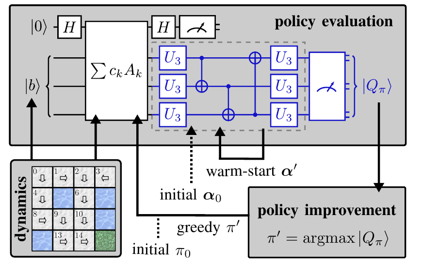{.publication-image .lightbox fig-alt="Variational quantum policy iteration workflow"}

Image credit: Figure 1, <a href="https://doi.org/10.1109/QCE60285.2024.00172">Meyer et al., QCE 2024</a> · © 2024 IEEE · <a href="https://ieeexplore.ieee.org/Xplorehelp/downloads/license-information/IEEE.html">reuse terms</a>

:::

::: {.publication-details}
**[Warm-Start Variational Quantum Policy Iteration](https://doi.org/10.1109/QCE60285.2024.00172)**

Nico Meyer, Jakob Murauer, Alexander Popov, Christian Ufrecht, Axel Plinge, Christopher Mutschler, Daniel D. Scherer.

*IEEE International Conference on Quantum Computing and Engineering (QCE)*, vol. 1, pp. 1458–1466, September 2024.

Variational quantum policy iteration uses a quantum subroutine to solve the linear-system step of reinforcement-learning policy iteration. The warm-start version reduces resource overhead and is evaluated on a FrozenLake task involving a 256-by-256 linear system.

:::
::::

:::: {.publication-card}
::: {.publication-figure}
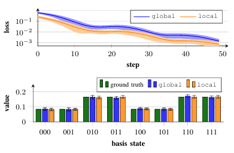{.publication-image .lightbox fig-alt="Variational linear-system solver results for loss and basis-state values"}

Image credit: Figure 1, <a href="https://doi.org/10.1109/QCE60285.2024.10242">Meyer et al., QCE 2024</a> · © 2024 IEEE · <a href="https://ieeexplore.ieee.org/Xplorehelp/downloads/license-information/IEEE.html">reuse terms</a>

:::

::: {.publication-details}
**[Comprehensive Library of Variational LSE Solvers](https://doi.org/10.1109/QCE60285.2024.10242)**

Nico Meyer, Martin Röhn, Jakob Murauer, Axel Plinge, Christopher Mutschler, Daniel D. Scherer.

*IEEE International Conference on Quantum Computing and Engineering (QCE)*, vol. 2, pp. 1–4, September 2024.

The variational-lse-solver framework brings together implementations of variational quantum algorithms for linear systems and adds practical improvements. It provides a common interface for researchers developing and comparing end-to-end applications.

:::
::::

:::: {.publication-card}
::: {.publication-figure}
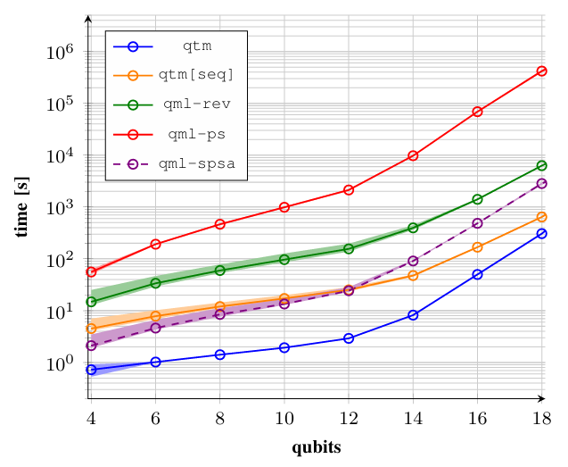{.publication-image .lightbox fig-alt="Runtime comparison of quantum machine-learning frameworks by qubit count"}

Image credit: Figure 1a, <a href="https://ieeexplore.ieee.org/document/10821318">Meyer et al., QCE 2024</a> · © 2024 IEEE · <a href="https://ieeexplore.ieee.org/Xplorehelp/downloads/license-information/IEEE.html">reuse terms</a>

:::

::: {.publication-details}
**[Qiskit-Torch-Module: Fast Prototyping of Quantum Neural Networks](https://ieeexplore.ieee.org/document/10821318)**

Nico Meyer, Christian Ufrecht, Maniraman Periyasamy, Axel Plinge, Christopher Mutschler, Daniel D. Scherer, Andreas Maier.

*IEEE International Conference on Quantum Computing and Engineering (QCE)*, vol. 1, pp. 817–823, September 2024.

Qiskit-Torch-Module connects Qiskit quantum neural networks with PyTorch for faster prototyping and training on a single machine. The reported benchmarks show large runtime improvements over comparable approaches while keeping integration with existing code straightforward.

:::
::::

## 2023

:::: {.publication-card}
::: {.publication-figure}
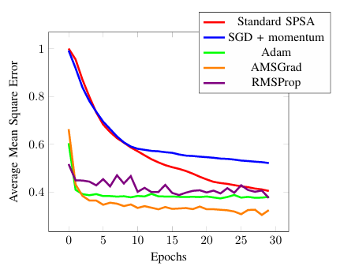{.publication-image .lightbox fig-alt="Comparison of optimizer mean-square errors across training epochs"}

Image credit: Figure 2, <a href="https://doi.org/10.1109/QCE57702.2023.00058">Wiedmann et al., QCE 2023</a> · © 2023 IEEE · <a href="https://ieeexplore.ieee.org/Xplorehelp/downloads/license-information/IEEE.html">reuse terms</a>

:::

::: {.publication-details}
**[An Empirical Comparison of Optimizers for Quantum ML with SPSA-based Gradients](https://doi.org/10.1109/QCE57702.2023.00058)**

Marco Wiedmann, Marc Hölle, Maniraman Periyasamy, Nico Meyer, Christian Ufrecht, Daniel D. Scherer, Axel Plinge, Christopher Mutschler.

*IEEE International Conference on Quantum Computing and Engineering (QCE)*, vol. 1, pp. 450–456, September 2023.

This study combines the low-cost gradient estimates of SPSA with conventional gradient-based optimizers for variational quantum circuits. In regression experiments, the hybrid method converges faster and more accurately than the compared alternatives, including under sampling and hardware noise.

:::
::::

:::: {.publication-card}
::: {.publication-figure}
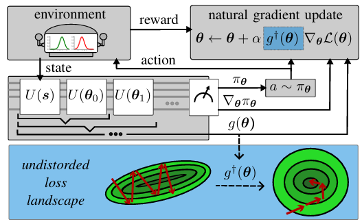{.publication-image .lightbox fig-alt="Quantum natural policy-gradient training workflow"}

Image credit: Figure 1, <a href="https://doi.org/10.1109/QCE57702.2023.10181">Meyer et al., QCE 2023</a> · © 2023 IEEE · <a href="https://ieeexplore.ieee.org/Xplorehelp/downloads/license-information/IEEE.html">reuse terms</a>

:::

::: {.publication-details}
**[Quantum Natural Policy Gradients: Towards Sample-Efficient Reinforcement Learning](https://doi.org/10.1109/QCE57702.2023.10181)**

Nico Meyer, Daniel D. Scherer, Axel Plinge, Christopher Mutschler, Michael J. Hartmann.

*IEEE International Conference on Quantum Computing and Engineering (QCE)*, vol. 2, pp. 36–41, September 2023.

Quantum natural policy gradients use an efficient approximation of the quantum Fisher information matrix to train reinforcement-learning policies. The experiments report faster, more stable learning and lower sample requirements than first-order training, with an additional demonstration on a 12-qubit device.

:::
::::

## 2022

:::: {.publication-card}
::: {.publication-figure}
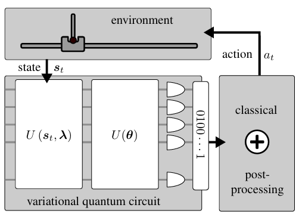{.publication-image .lightbox fig-alt="Variational quantum circuit and classical action-decoding workflow"}

Image credit: Figure 1, <a href="https://proceedings.mlr.press/v202/meyer23a.html">Meyer et al., ICML 2023</a> · © 2023 authors

:::

::: {.publication-details}
**[Quantum Policy Gradient Algorithm with Optimized Action Decoding](https://proceedings.mlr.press/v202/meyer23a.html)**

Nico Meyer, Daniel D. Scherer, Axel Plinge, Christopher Mutschler, Michael J. Hartmann.

*International Conference on Machine Learning (ICML)*, PMLR vol. 202, pp. 24592–24613, July 2023.

The paper improves quantum policy-gradient training by optimizing how measurements of a variational quantum circuit are decoded into actions. The method performs better across several benchmarks and enables a complete training run on a five-qubit quantum device.

:::
::::

:::: {.publication-card}
::: {.publication-figure}
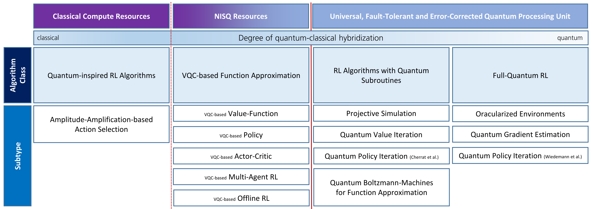{.publication-image .lightbox fig-alt="Classification of approaches to quantum reinforcement learning"}

Image credit: Figure 1, <a href="https://arxiv.org/abs/2211.03464v2">Meyer et al., arXiv (2022)</a> · © 2022 authors

:::

::: {.publication-details}
**[A Survey on Quantum Reinforcement Learning](https://doi.org/10.48550/arXiv.2211.03464)**

Nico Meyer, Christian Ufrecht, Maniraman Periyasamy, Daniel D. Scherer, Axel Plinge, Christopher Mutschler.

arXiv:2211.03464, 2022.

This survey organizes the quantum reinforcement-learning literature, covering both variational-circuit methods for current noisy devices and approaches that rely on future fault-tolerant hardware. It compares the assumptions and potential advantages of the different lines of research.

:::
::::

:::: {.publication-card}
::: {.publication-figure}
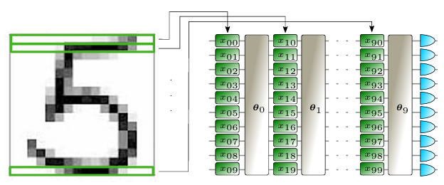{.publication-image .lightbox fig-alt="Incremental encoding of an image into quantum classifier circuits"}

Image credit: Figure 1, <a href="https://doi.org/10.1109/QCE53715.2022.00021">Periyasamy et al., QCE 2022</a> · © 2022 IEEE · <a href="https://ieeexplore.ieee.org/Xplorehelp/downloads/license-information/IEEE.html">reuse terms</a>

:::

::: {.publication-details}
**[Incremental Data-Uploading for Full-Quantum Classification](https://doi.org/10.1109/QCE53715.2022.00021)**

Maniraman Periyasamy, Nico Meyer, Christian Ufrecht, Daniel D. Scherer, Axel Plinge, Christopher Mutschler.

*IEEE International Conference on Quantum Computing and Engineering (QCE)*, vol. 1, pp. 31–37, September 2022.

Incremental data uploading interleaves feature-encoding gates with trainable gates so high-dimensional data can enter a quantum classifier without costly preprocessing. Comparisons on MNIST and Fashion-MNIST assess classification accuracy and model expressivity against other encoding schemes.

:::
::::
